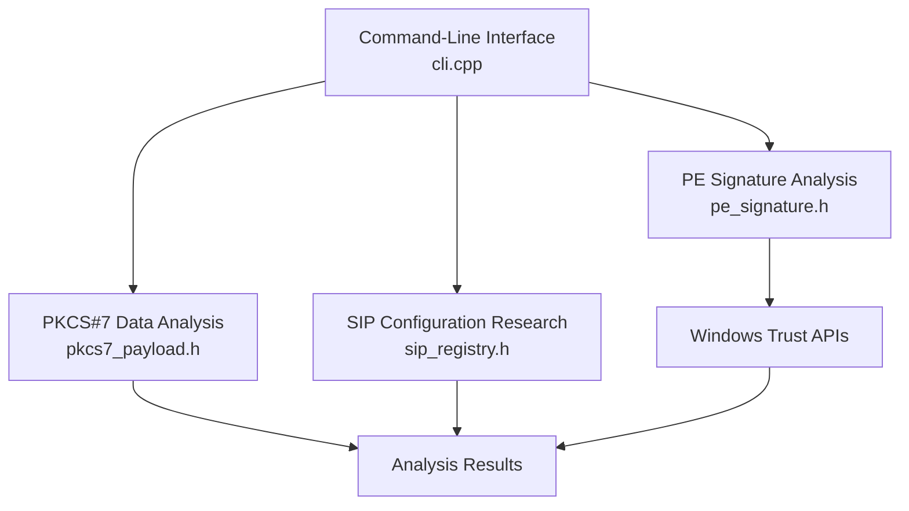

# 🛡️ SigLab
### Windows Authenticode Research & PE Signature Analysis

<p align="center">
  
  
  
  
  
</p>

> **⚠️ Educational & Authorized Research Only**
>
> SigLab is a Windows security research project focused on PE executable signatures and Authenticode verification. Conduct experiments only in isolated laboratory environments using systems and files you are authorized to analyze.

---

## 📌 Repository

**GitHub:** https://github.com/detectorefi-byte/siglab

**Clone the repository:**

```bash
git clone https://github.com/detectorefi-byte/siglab.git
cd siglab
```

---

## 📖 Overview

**SigLab** is a C++ research toolkit designed to explore how Windows handles executable signature metadata and evaluates application trust.

The project investigates the relationship between the Portable Executable (PE) format, Authenticode signatures, PKCS#7/CMS structures, Cryptographic Subject Interface Packages (SIPs), and the Windows `WinVerifyTrust` API.

SigLab is intended for:

- Windows internals researchers
- Reverse engineers
- Digital forensics practitioners
- Application security researchers
- Students studying Windows executable formats
- Developers interested in code-signing mechanisms

The goal is to make Windows trust-verification mechanisms easier to inspect, understand, and document.

---

## 🎯 Research Objectives

SigLab explores several important Windows security concepts:

- PE headers and executable structure
- Embedded certificate-table metadata
- Authenticode signature verification
- PKCS#7 and CMS signed-data structures
- Executable digest validation
- Windows trust-verification interfaces
- Cryptographic SIP configuration
- Windows code-integrity reporting
- Reproducible security research in isolated environments

---

## ✨ Features & Research Areas

| Component | Description |
|---|---|
| 🔍 PE Inspection | Examines PE headers and certificate-table metadata. |
| 🔏 Authenticode Research | Investigates executable signature-verification behavior. |
| 🧬 PKCS#7/CMS Analysis | Explores cryptographic signed-data structures. |
| 🧪 Digest Validation | Studies the relationship between executable content and signature integrity. |
| ⚙️ Windows Trust APIs | Researches the `WinVerifyTrust` verification pipeline. |
| 🗂️ SIP Research | Examines Windows file-type-specific signature processing. |
| 🛡️ Code Integrity | Investigates Windows code-integrity reporting interfaces. |
| 🧹 Configuration Recovery | Documents safe restoration and verification of lab configurations. |

**Note:** Actual functionality depends on the implementation in the current source code. The table describes research areas, not independently verified test results.

---

## 🏗️ System Architecture

The project is organized around a command-line interface and specialized components for executable inspection and signature-related data analysis.



### Source Code Structure

```text
siglab/
├── src/
│   ├── cli.cpp
│   ├── pe_signature.h
│   ├── pkcs7_payload.h
│   └── sip_registry.h
├── SigLab.sln
├── SigLab.vcxproj
├── SigLab.vcxproj.filters
├── .gitignore
└── README.md
```

The directory structure above reflects the expected project layout. Adjust it if the actual repository differs.

---

## 🧰 Technology Stack

| Technology | Purpose |
|---|---|
| C++ | Core implementation |
| Microsoft Visual Studio | Development and compilation |
| Windows SDK | Windows development interfaces |
| Portable Executable (PE) | Executable file format under investigation |
| `WinVerifyTrust` | Windows trust-verification interface |
| PKCS#7/CMS | Cryptographic signed-data formats |

The configured C++ standard, Windows SDK version, compiler toolset, and dependencies should be confirmed in the Visual Studio project files.

---

## 💻 Requirements

Before building SigLab, verify that you have:

- Windows 10 or Windows 11
- Microsoft Visual Studio
- The Desktop development with C++ workload
- A compatible Windows SDK
- The compiler toolset configured in `SigLab.vcxproj`
- Any additional dependencies required by the source code

Exact requirements may vary depending on the project's configuration.

---

## 🚀 Build Instructions

### 1. Clone the repository

```bash
git clone https://github.com/detectorefi-byte/siglab.git
cd siglab
```

### 2. Open the Visual Studio solution

Open `SigLab.sln` in Microsoft Visual Studio.

### 3. Review the project configuration

Check the following settings:

- Windows SDK version
- Target architecture
- Build configuration
- C++ language standard
- Compiler toolset
- Required libraries and dependencies

### 4. Build the solution

In Visual Studio:

1. Select the appropriate configuration and platform.
2. Open the **Build** menu.
3. Select **Build Solution**.
4. Review the Output window for errors.

### 5. Verify the build

Confirm that the compilation succeeds and that the expected executable is generated in the configured output directory.

Test only in an isolated lab environment.

---

## 🔬 Research Methodology

For consistent and reproducible results, use the following workflow:

1. Record the Windows version and development toolchain.
2. Use test executables you own or are authorized to analyze.
3. Record baseline signature-verification results.
4. Inspect the relevant PE structures and signature metadata.
5. Compare observations against documented Windows behavior.
6. Preserve relevant logs and test results.
7. Record any configuration changes made during the experiment.
8. Restore the original lab environment and verify recovery.

### Important Distinctions

A certificate table being present does not necessarily mean that an executable has a valid signature.

These are distinct properties:

- **Signature presence:** Signature-related data exists in the file.
- **Integrity validation:** The signature correctly authenticates the relevant content.
- **Certificate validation:** The certificate and its chain satisfy applicable validation requirements.
- **Trust evaluation:** Windows evaluates the signature under the applicable verification policy.

Understanding these distinctions is essential when researching executable trust.

---

## 🛡️ Security Considerations

SigLab investigates Windows components that can affect security-sensitive trust decisions.

Follow these precautions:

- Prefer read-only inspection wherever possible.
- Use disposable virtual machines for experiments.
- Create a recoverable snapshot before testing configuration changes.
- Do not modify third-party software without authorization.
- Avoid experimental trust-policy changes on production systems.
- Keep a record of the initial configuration and all changes.
- Verify that the laboratory environment has been restored after testing.

A research result should not be interpreted as proof that an executable is safe or malicious without additional evidence.

---

## 🧪 Testing & Validation

When documenting a test, include:

| Field | Information |
|---|---|
| Operating System | Windows version and build |
| Architecture | x64 or other applicable architecture |
| Toolchain | Visual Studio and compiler version |
| Test Input | Authorized test executable |
| Initial State | Baseline signature-verification result |
| Observation | Actual behavior recorded during testing |
| Final State | Verification that the environment was restored |

Only report features as tested or verified after reproducing the corresponding behavior.

---

## ⚖️ Legal Disclaimer

SigLab is intended for educational purposes and authorized security research.

Users are responsible for complying with applicable laws, organizational policies, software licenses, and authorization requirements.

Do not use this project for unauthorized access, unlawful tampering, or activities intended to evade security controls.

The project is provided for research and educational use without warranties. No guarantee is made regarding suitability for a particular purpose, compatibility, or results.

---

## 🤝 Contributing

Contributions that improve documentation, correctness, testing, reproducibility, and defensive security research are welcome.

When proposing changes:

1. Describe the problem or research objective.
2. Document relevant Windows and toolchain versions.
3. Provide reproducible test results where possible.
4. Explain relevant compatibility or security considerations.
5. Keep changes focused and clearly documented.

---

## 📄 License & Usage Permissions

No open-source license has been specified for this repository.

The repository is publicly accessible on GitHub, but public visibility does not automatically grant permission to copy, modify, redistribute, or commercially reuse its contents.

All rights not otherwise granted remain with the applicable copyright holder. Third-party components may be subject to their own licenses.

---

<p align="center">
  <b>SigLab</b>
  <br>
  Windows Internals · Authenticode Research · Digital Forensics
  <br><br>
  <a href="https://github.com/detectorefi-byte/siglab">View Repository</a>
</p>
